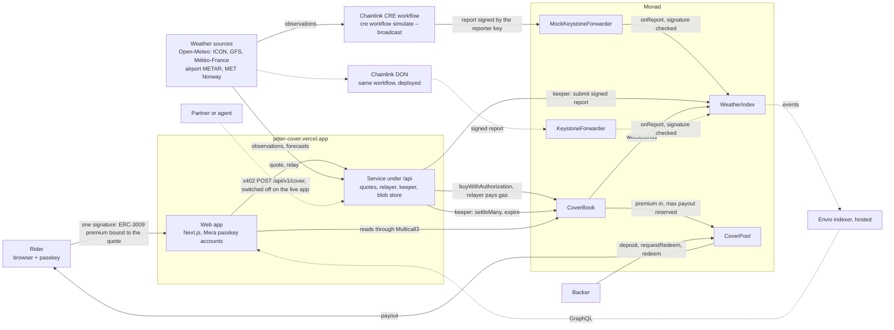

# Pitter

Rain cover you switch on for one shift. It costs a fraction of a cent a minute while it is on, and when heavy rain (1 mm an hour or more) hits your area (about 5 km), it pays you for every minute of it, while it is still raining.

Pitter is for people who work outdoors by the shift, starting with bike and scooter couriers, for whom a downpour means fewer orders and a harder shift. Sign in with Face ID or a fingerprint, add dollars, turn cover on. There is nothing to install and no claim to file.

- **Live app:** <https://pitter-cover.vercel.app> on Monad testnet, in practice mode (practice dollars and a simulator area where you make the rain).
- **Mainnet pilot:** the same contracts on Monad mainnet with real native USDC, a pool of under one dollar and cover sold for cents. On 13 October two covers in Colombo and Davao were paid in full from real heavy rain (bought while it was already raining, so they were priced above what they could pay), and an over-limit sale in Warsaw was refused on chain. Every transaction is listed in [PROOF.md](PROOF.md).

| Read next | |
|---|---|
| [JUDGES.md](JUDGES.md) | a five-minute review path with exact links |
| [PROOF.md](PROOF.md) | every on-chain claim as an explorer link, and `cast` commands to re-check them |
| [CLAIMS.md](CLAIMS.md) | every public statement tagged by how it can be checked, and what we do not claim |
| [MOCKS.md](MOCKS.md) | the exact line between what is real and what is simulated |
| [docs/](docs) | [architecture](docs/architecture.md), [pricing](docs/pricing.md), [API for partners and agents](docs/api.md), [security](docs/security.md) |

## Try it in 60 seconds

You need a passkey manager that supports the WebAuthn PRF extension: iCloud Keychain, Google Password Manager, 1Password, or Windows Hello on Windows 11 25H2 or newer. Bitwarden, Dashlane and a local Chrome profile do not work yet.

1. Open <https://pitter-cover.vercel.app/app>.
2. **Sign up.** One passkey prompt creates your account. There is no seed phrase and nothing to install.
3. **Get practice dollars** from the simulator panel. They have no value.
4. **Use the simulator area** and **turn cover on**. The offer says what cover costs a minute and what it pays you a minute of heavy rain; "why this price" shows the forecast behind it.
5. **Make it rain in the simulator area.** Rain counts from the next weather check, and only for minutes inside your cover, so wait until your cover has run for a minute.
6. **Run a weather check.** The oracle reports the rain, the keeper settles your cover, and the payout lands in your balance. Every step links to its transaction on the explorer.

Sign out, clear the site's storage and sign in again: the passkey alone brings back the same account and its cover history.

## How it works

1. **Price.** The forecast for your area sets the price of the next block of cover: the chance of heavy rain from three weather models, taking the wettest of them, times what you would be paid, plus a 25% margin. If any weather source already reports rain, the next hour is priced as likely wet, so cover for rain that is already falling is never cheap.
2. **Buy.** One passkey signature authorises the payment and commits to the exact terms of the quote. A relayer submits it and pays the gas, so you never need anything but dollars.
3. **Check.** Every five minutes an oracle reads up to five weather sources for every area with cover, calls an area wet when at least two answer and their median is 1 mm an hour or more, signs the result and writes it on chain.
4. **Pay.** Anyone can settle a cover. It pays `wet seconds × your rate`, capped at the maximum you bought, straight to your balance.

Payouts come from a shared pool of dollars put in by backers, who earn the cover fees. The pool reserves the maximum payout of every cover it sells and refuses a sale it cannot back, in total (80% of its capital) and per area (25%). Backers leave through a 13-hour notice and wait for the cover sold before their request to close, so capital cannot step out ahead of a storm everyone can see coming.

## Architecture



Solid edges run today. Dotted edges are built but not live: delivery from Chainlink's production DON (deploying a workflow there needs a commercial agreement with Chainlink), a hosted indexer (the indexer is configured for both networks, runs locally and is tested; the app reads the chain directly), and paid cover over x402 (implemented and tested, switched off on the live deployment). Details: [docs/architecture.md](docs/architecture.md).

## Packages

| Path | What it is |
|---|---|
| [`contracts/`](contracts) | Solidity (Foundry): `CoverBook` (cover, signed quotes, settlement, served areas), `CoverPool` (ERC-4626 pool with exposure caps and ERC-7540-style exits after notice), `WeatherIndex` (signed weather reports, Chainlink CRE receiver), `TestDollar` (practice dollars, test network only) |
| [`packages/core`](packages/core) | Shared TypeScript: ABIs, deployments, EIP-712 types, the area grid, weather sources and the wet/dry decision, pricing, refusal codes |
| [`workflow/`](workflow) | The oracle as a Chainlink Runtime Environment workflow, built with the official SDK |
| [`service/`](service) | Quotes, gasless relaying, the keeper, paid cover over x402 for partners and agents, encrypted blob storage |
| [`indexer/`](indexer) | Envio HyperIndex: cover history, exposure per area, pool statistics, exits |
| [`web/`](web) | The app: cover for riders, the backers' desk, the partner docs, the private shift log |

Each package except `web/` has its own README with setup and test instructions.

## Deployments

**Monad mainnet (chain 143), pilot with native USDC.** Source verified (exact creation and runtime match) on Monad's Sourcify instance, shown on MonadVision.

| Contract | Address |
|---|---|
| CoverBook | [`0x8C7f6A8b09176c893da3ee4C1cbCd2d8ec26E770`](https://monadvision.com/address/0x8C7f6A8b09176c893da3ee4C1cbCd2d8ec26E770) |
| CoverPool | [`0x58d970780565E4C064369AD80eEC2D3581d6d75D`](https://monadvision.com/address/0x58d970780565E4C064369AD80eEC2D3581d6d75D) |
| WeatherIndex | [`0x171CFCBAA60C9AfD267474773122293a67FbeD94`](https://monadvision.com/address/0x171CFCBAA60C9AfD267474773122293a67FbeD94) |
| USDC (native) | [`0x754704Bc059F8C67012fEd69BC8A327a5aafb603`](https://monadvision.com/address/0x754704Bc059F8C67012fEd69BC8A327a5aafb603) |

Cover is sold only in 52 served areas: a 5 × 8 grid over Warsaw and one area each in Colombo, Davao, Bergen, Singapore, Kuala Lumpur, Manila, Mumbai, Bogotá, Jakarta, Ho Chi Minh City, Bangkok and Medellín. The largest payout of one cover is 0.20 USDC. Record: [`contracts/deployments/143.json`](contracts/deployments/143.json).

**Monad testnet (chain 10143), the live app.** Source verified (runtime match) on the same Sourcify instance.

| Contract | Address |
|---|---|
| CoverBook | [`0xE0951FC7640Da8bA5071693007607FBa31592ee4`](https://testnet.monadvision.com/address/0xE0951FC7640Da8bA5071693007607FBa31592ee4) |
| CoverPool | [`0x80375eB8BE28a7bffb274C2620E9D70Fe7E70B9f`](https://testnet.monadvision.com/address/0x80375eB8BE28a7bffb274C2620E9D70Fe7E70B9f) |
| WeatherIndex | [`0x55F06d63A97ae82c67383cFB26B82Fda78e58664`](https://testnet.monadvision.com/address/0x55F06d63A97ae82c67383cFB26B82Fda78e58664) |
| TestDollar | [`0x27fe944e3b7037ED9F75b17123b6e2E716DEeF10`](https://testnet.monadvision.com/address/0x27fe944e3b7037ED9F75b17123b6e2E716DEeF10) |

Record, including the reporter, underwriter and limits: [`contracts/deployments/10143.json`](contracts/deployments/10143.json).

## What Monad gives this

- **Short blocks.** In the recorded testnet run the payout landed three blocks, about one second, after the weather report it paid for; on mainnet the settlement followed the last report by five seconds. Cover that pays while it is still raining needs that.
- **`eth_sendRawTransactionSync`.** The relayer sends with it where the node supports it and gets the receipt in the same call.
- **Gas charged on the limit.** Monad bills the gas limit, not the gas used, so every relayed call has its own limit, measured as the worst case on a local chain under Monad's rules (`anvil --network monad`, `network = "monad"` in Foundry) plus headroom. The receipts in [PROOF.md](PROOF.md) show `gasUsed` equal to the limit.
- **Native USDC with ERC-3009.** The buyer's one signature is a `ReceiveWithAuthorization` whose nonce is the quote's hash and whose payee is the book, so it pays for exactly that cover and nothing else, whoever submits it.
- **Mera passkey accounts.** The account key is derived from the passkey's PRF output through Category Labs' Mera library; a second PRF namespace of the same passkey encrypts the rider's private shift log.

## Tests

| Package | Command | Result |
|---|---|---|
| contracts | `cd contracts && forge test` | 412 passed; 10 fork tests against native USDC skipped without an RPC (422 with `MONAD_RPC_URL=https://rpc.monad.xyz`). Includes 16 fuzz tests and 12 invariants, each invariant checked over 64 runs of 128 calls (8,192 calls) |
| core | `pnpm --filter @cover/core test` | 154 passed |
| service | `pnpm --filter @cover/service test` | 434 passed, 1 skipped (a Postgres case) |
| workflow | `pnpm --filter @cover/workflow test` | 45 passed |
| indexer | `cd indexer && docker compose run --rm --build --no-deps indexer pnpm test` | 37 passed (the Envio runtime needs Linux, hence Docker) |
| web | `pnpm --filter @cover/web test` | 258 passed |
| web, end to end | `pnpm --filter @cover/web test:e2e` | 2 Playwright tests in Chromium with a virtual passkey that has PRF, against the test network: sign up, practice dollars, cover in the simulator area, rain, payout, sign in again from nothing; the shift log opened in a second browser |

```bash
pnpm install
git submodule update --init
pnpm --filter @cover/core test
cd contracts && forge test
```

## Limits

- **The oracle is one reporter key** until reports are delivered by Chainlink's production DON. Today the workflow runs through `cre workflow simulate --broadcast` on the maintainers' machine, and the live app's keeper also submits signed reports. The contracts check the reporter's signature on every path, so the permissionless simulation forwarder cannot inject a report, but whoever holds the key decides what was wet.
- **The underwriter and relayer are hot keys** on the server. The underwriter can commit pool capital only up to the on-chain caps; the relayer only pays gas.
- **Pricing uses free forecast models.** Open-Meteo's free tier is for non-commercial use; a commercial deployment needs a commercial weather licence. Three of the five sources are models served by that one provider. The pricing model has not been tested against real loss data.
- **It is cover, not regulated insurance.** There is no insurer, no regulator and no claims process.
- **Mainnet is a pilot with cents.** The pool holds under one USDC and one cover pays at most 0.20 USDC. The contract owner on both networks is the deployer key, not a multisig, and the pilot uses the same reporter and underwriter keys as the test network.
- **Leaving the pool needs MON for gas.** Requests and claims act on the sender and cannot be relayed.
- **Passkeys need PRF.** See the list under "Try it in 60 seconds".

Security: an independent review before the mainnet deployment found no critical or high-severity issues. It found three medium and two low ones; all are fixed and covered by regression tests. See [docs/security.md](docs/security.md).

## Development

AI coding tools were used in building this project, as the Metropolis hackathon rules require us to disclose.

## License

[MIT](LICENSE)
