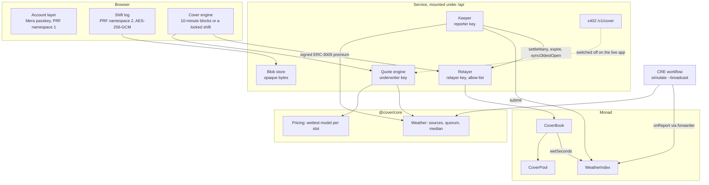

# Architecture

How a cover is priced, bought, judged and paid, and which component does each part. The package READMEs
([contracts](../contracts/README.md), [core](../packages/core/README.md), [workflow](../workflow/README.md),
[service](../service/README.md), [indexer](../indexer/README.md)) go deeper; this page connects them.



## Contracts

Three contracts on Monad, plus a test token on the test network. Solidity 0.8.30, OpenZeppelin 5.7.

**`CoverBook`** sells cover against quotes signed by the underwriter key. A quote names the holder, the area
key, a minute-aligned window, the payout per wet second and the premium. At sale the book checks, in order:
the quote has not expired, the underwriter signed it, it has not been used, the window is valid and within
the horizon (it may end at most 12 h 30 min after the purchase), it starts after the lead time (10 minutes on
mainnet), the maximum payout is within the per-cover limit, the premium is above the floor, the area is
served (mainnet sells only in served areas), the oracle is fresh (a report within the last 20 minutes) and an
active-area slot is free (64 at most). Then it asks the pool to reserve the maximum payout.

Settlement is open to anyone. `settle` and `settleMany` pay what the index has confirmed since the last
settlement: `wet seconds × rate`, capped at the maximum, rounded in the pool's favour. A cover closes when its
window is fully reported; after `end + expiryGrace` (24 hours) anyone can `expire` it, which pays what was
reported and releases the rest. There are no refunds and no cancellations: a refundable cover would be a
free option on the forecast.

`oldestOpenId` marks the oldest cover that may still be open. Each close walks it forward over up to 32 closed
covers; `syncOldestOpen` walks it further. Backers' exits wait on it.

**`CoverPool`** is an ERC-4626 vault over the dollar token. It holds the capital, receives the premiums net of
the fee, reserves the remaining maximum payout of every open cover (`lockedExposure` in total,
`cellExposure` per area) and pays the holders. Only the book can lock, release and pay. Caps are checked when
exposure is locked, against `activeAssets()`, the capital that has not asked to leave: at most 80% in total
and 25% per area. Deposits are immediate; leaving takes notice (below).

**`WeatherIndex`** keeps, for each key `(triggerId << 64) | cellId`, a timeline of checkpoints
`(timestamp, cumulative wet seconds)` and answers `wetSeconds(key, a, b)`, interpolating inside a reported
interval. Each checkpoint packs into one 32-byte storage slot (`uint64` time, `uint192` total), and a key's
checkpoints sit in one contiguous array, searched by bisection. The timeline only grows forward, a reading can
never add more wet seconds than the time it covers, and a report is accepted once.

Reports arrive two ways, `onReport` from an allowlisted Chainlink forwarder or `submit` from anyone, and on
both the report must carry the reporter's EIP-712 signature. The heartbeat is the report's `issuedAt` (or its
landing time, if issued ahead of the chain clock), so a report held back and delivered late cannot make a
silent oracle look alive.

**`TestDollar`** is the practice dollar: six decimals, ERC-2612, ERC-3009, an open rate-limited `drip`. The
deploy script refuses to deploy it outside the test network or a local chain.

## Money flow

```
buyer --(ERC-3009 ReceiveWithAuthorization, nonce = hashQuote(quote))--> CoverBook
CoverBook --(fee, 5%)--> treasury
CoverBook --(premium - fee)--> CoverPool            pool.lock(key, maxPayout)

oracle report --> WeatherIndex
anyone --settle--> CoverBook --pool.pay(holder, key, wetSeconds × rate, capped)--> holder
                              --pool.release(key, unused reservation) on close

backer --deposit / depositWithAuthorization--> CoverPool (shares)
backer --requestRedeem--> escrow; after notice and older cover closed --redeem / withdraw--> backer
```

The book holds nothing at rest: a gasless premium passes through it inside the purchase. If the token
refuses a payout (an issuer block), the amount is set aside in the pool under `deferred[holder]` and the cover
still closes; `claimDeferred(holder)` retries it.

**Leaving the pool.** A backer calls `requestRedeem`; the shares go into escrow and the request records the
book's `policyCount`. It can be collected once the 13-hour notice is over and every cover sold before it has
closed (`oldestOpenId > lastPolicyAtRequest`). From the request on, that capital no longer counts toward the
caps, earns nothing further (a claim pays the lower of the share value at the request and at the claim; the
difference goes to the treasury, not to the backers who stay) and still bears losses until it is claimed. The
notice is always at least the cover horizon plus 30 minutes, so cover ends before the capital behind it can
leave.

## Oracle

The decision logic is `@cover/core/weather`, shared by the CRE workflow and the service's keeper.

- **Sources, per area:** three forecast models served by Open-Meteo (DWD ICON, NOAA GFS, Météo-France: the
  last 15 minutes of precipitation), the latest METAR of the nearest airport within 40 km, and MET Norway's
  current hour. Stale answers are dropped: an observation older than 90 minutes, a model step older than an
  hour, a forecast older than two hours.
- **Verdict:** wet when at least two sources answer and their median is at or above 1.0 mm an hour; dry when
  at least two answer and it is below; no verdict otherwise. An area without a verdict gets no reading, and
  time never reported counts as dry.
- **Report:** one reading per area, continuing each area's timeline from where it ended
  (`lastTo(key)`), signed by the reporter key (EIP-712 `Report(Reading[] readings, uint64 issuedAt)`), at
  most 20 readings per report.
- **Heartbeat:** while no cover is open, the oracle still observes one reference area (Warsaw) so that the
  first cover can be sold. If no source answers, nothing is written, the heartbeat ages past 20 minutes and
  the book stops selling.

**Delivery today.** The CRE workflow (`workflow/`), compiled to WASM with Chainlink's SDK, runs every five
minutes with `cre workflow simulate --broadcast`; the report reaches `WeatherIndex.onReport` through
Chainlink's MockKeystoneForwarder. On the test network the live app's keeper also reports, with `submit`.
**Next:** the same workflow deployed to Chainlink's production DON, delivering through the
KeystoneForwarder already allowlisted on mainnet. That needs a commercial agreement with Chainlink; the
contracts and the workflow need no change. See [MOCKS.md](../MOCKS.md).

## Pricing

`@cover/core/pricing` prices from the same sources that settle: the wettest of three models per 15-minute
slot, never below 1%, at least 90% for slots in the coming hour while any source reports rain, plus a 25%
margin. The full rule, worked examples and limits are in [pricing.md](pricing.md).

## Account layer

The app has one account primitive: a passkey, through Category Labs' Mera library
(`@category-labs/mera`). There is no seed phrase to write down, no extension and no stored key.

- **Namespace 1, the account.** Signing up is one WebAuthn creation ceremony with the PRF extension; signing
  in is one assertion with a discoverable credential, so it works on a device that has never seen the
  account. The 32-byte PRF output under Mera's default salt is read as the entropy of a 24-word BIP-39 phrase,
  and the account key is the first EVM account of that phrase (`m/44'/60'/0'/0/0`). The same passkey gives
  the same account on any device; the phrase is a standard way out should the account ever need to move.
  The PRF output and the derived key are zeroed once a Mera signing session holds the key in memory. Nothing
  identifying is stored; the address is recomputed from the passkey each time.
- **The session scope.** A sign-in lasts at most four hours and ends after 20 idle minutes (suspended while
  cover is on). Without a new prompt it signs one kind of thing: a cover payment to the book, up to $5 in any
  60 minutes. Anything else, such as a cash-out or a pool deposit, takes a fresh passkey prompt.
- **Namespace 2, the shift log.** A rider's private notes about their shifts (earnings, where, when) are
  encrypted on the device. The salt `sha256("pitter.shiftlog.v1")` gives an unrelated PRF output from the same
  passkey; HKDF-SHA-256 turns it into a non-extractable AES-256-GCM key and a separate secp256k1 storage
  identity, not linked to the account address. The ciphertext (`"PSL1" || iv || ciphertext || tag`, with the
  namespace as associated data) is stored in the service's blob store, which authenticates each write and
  read by an EIP-712 signature of the storage identity and keeps bytes it cannot read. The log locks whenever
  the sign-in ends; opening it takes its own prompt.
- **Which authenticators work.** PRF is required: iCloud Keychain, Google Password Manager, 1Password,
  Windows Hello on Windows 11 25H2 or newer. Not Bitwarden, Dashlane or a local Chrome profile.

## Relayer

One hot key pays the gas, so a buyer needs only dollars. Every transaction passes one gate
(`service/src/relayer`):

1. the target and the four-byte selector must be on the allow-list, which is built from function signatures
   and checked against the ABIs at start; callers supply arguments, never targets, selectors, gas or value;
2. the node must be on the configured chain, the key funded, the base fee under a cap;
3. holding the nonce, the call is simulated against the latest state, and a call that would revert is refused
   at no cost;
4. it is signed with an explicit nonce, gas limit and fees and sent with `eth_sendRawTransactionSync` where
   the node supports it, which returns the receipt in the same call.

Monad bills the gas limit rather than the gas used, so each allowed call has its own limit: the worst case
measured on `anvil --network monad` plus headroom for native USDC (700,000 for `buyWithAuthorization`, for
example; the table is in the [service README](../service/README.md#how-the-pieces-work)). The nonce is held
from simulation to receipt, in Postgres behind a row lock when several instances run.

Everything the relayer submits is signed by someone else or open to anyone, and pays only the signed or
recorded party: the relayer cannot redirect a payment or change a cover.

## Keeper

One tick (`POST /api/cron/tick`, scheduled, or the "weather check" in practice mode):

1. read the areas with open cover and ask `@cover/core/weather` about them and the reference area;
2. submit one signed report for the areas with a verdict, chained from each area's last reported minute;
   with no open cover it refreshes the heartbeat only when it is about to go stale
   (`KEEPER_IDLE_HEARTBEAT_SECONDS`), so an idle deployment does not pay for empty reports;
3. walk `oldestOpenId` forward with `syncOldestOpen` when covers closed out of order have left it behind;
4. settle the covers that have a payout due or a fully reported window, in `settleMany` batches sized to fit
   the gas limit;
5. `expire` covers whose window ended more than the grace period ago without being fully reported.

The keeper walks the book with a cursor, so every open cover is read at least once per pass over the open
range. Settlement is permissionless: if the keeper stops, anyone, the holder included, can settle.

## Paid cover for partners and agents

`POST /api/v1/cover` sells cover for any holder against an x402 payment: answer 402 with the price, verify and
settle the payment through a facilitator, then buy the cover from the relayer's balance. A payment buys one
cover once, however often it is sent. It is implemented and tested and switched off on the live app. See
[api.md](api.md).

## Indexer

`indexer/` is an Envio HyperIndex project over the three contracts on both networks: cover history and
payouts per holder, exposure per area, weather readings, pool totals and a daily series, exit requests, and
served areas. It runs locally with Docker Compose and its handler tests run on simulated events. It is not
hosted yet; the app reads the chain directly through Multicall3, behind an interface an indexer can replace.
Queries: [indexer/queries.md](../indexer/queries.md).

## Monad specifics, in one place

| What | Where it matters |
|---|---|
| Short blocks and fast finality | Payout three blocks after the report in the testnet run; covers bought, reported and paid within minutes |
| Gas billed on the limit | Per-call gas limits in the relayer and the workflow (`gasLimitBase`, `gasLimitPerReading`); receipts show `gasUsed` equal to the limit |
| `eth_sendRawTransactionSync` | The relayer's send path |
| Monad execution rules in tests | `network = "monad"` in `foundry.toml`; the service's integration tests run on `anvil --network monad` |
| Native USDC with ERC-3009 | Gasless purchases and deposits; a fork suite runs the book and the pool against the real token |
| Mera passkey accounts | The whole account layer and the second PRF namespace |
